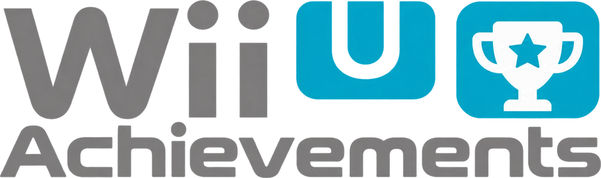
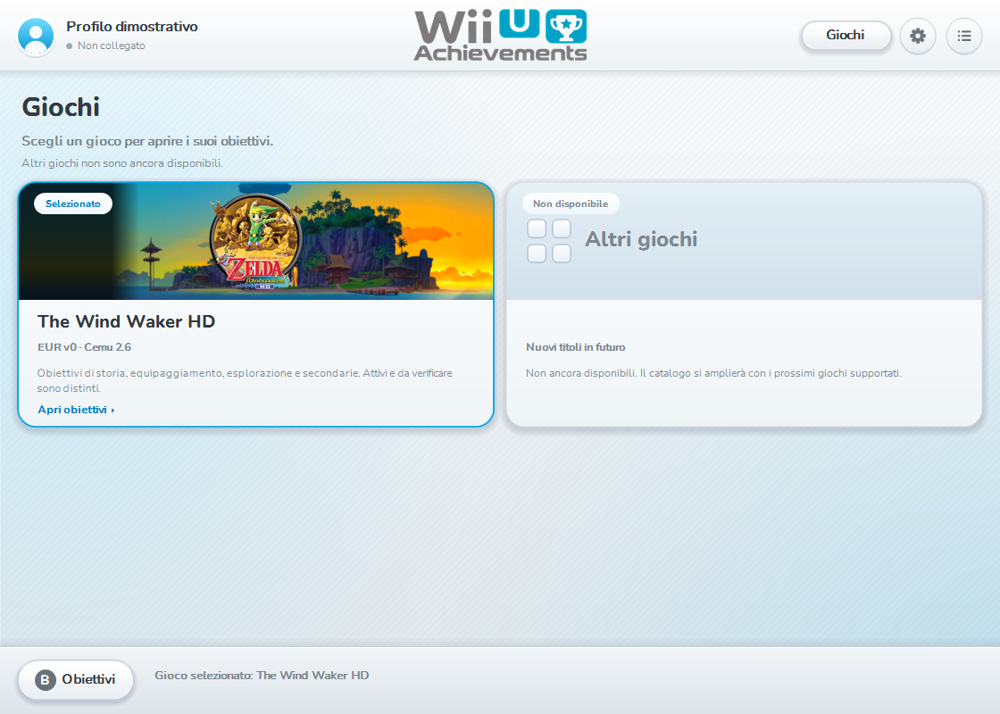

<p align="center"></p>

# Wii U Achievements

Sistema di obiettivi indipendente per giochi Wii U emulati su PC, scritto da zero
in C# 5 / .NET Framework x64. Primo gioco supportato: **The Wind Waker HD EUR v0
su Cemu 2.6**, RPX **cdc68acd**. Nessuna dipendenza da EmuHook o RetroAchievements.

**Stato del 30 ottobre 2026 — Playthrough TEST:** 110 obiettivi nel catalogo,
**70 eseguibili**, di cui **53 rilevamenti sperimentali**, e **40 non implementati**.
I rilevamenti sperimentali sono disponibili per prove progressive durante la
partita: non costituiscono un set completo verificato. Le prove reali e i limiti
sono in [VALIDATION](docs/VALIDATION.md) e [PLAYTHROUGH](docs/PLAYTHROUGH.md).


Le immagini della documentazione usano soltanto dati dimostrativi. L'interfaccia
mantiene i loghi proporzionati e centrati, il video di Isola Primula, pergamena,
vento, onde e cornici semplici blu/oro. Il catalogo Giochi usa lo stile neutro;
ogni gioco ha il proprio tema. [Dettagli dell'interfaccia](docs/UI.md).

## Avvio

1. Compila con `build.ps1`, oppure usa il tuo eseguibile locale aggiornato.
2. Apri `WiiUAchievements.exe` nella directory principale del progetto.
3. In **Impostazioni** scegli il percorso di `Cemu.exe` e il profilo locale.
4. Avvia il gioco supportato e premi **Collega Cemu**. Puoi collegarti dalla
   selezione file: il rilevamento attende una partita giocabile e stabile.
5. Lascia aperta l'app mentre giochi; puoi ridurla a icona.

Sono necessari Windows x64 e .NET Framework 4.x. Non servono Python, NuGet,
un account o Internet per giocare con progressi locali. Python serve soltanto
agli strumenti facoltativi per preparare le immagini. Cemu e il gioco non sono
inclusi. Normalmente basta il doppio clic, con gli stessi privilegi di Cemu.

## Configurazione supportata

| Voce | Valore |
| --- | --- |
| Emulatore | Cemu 2.6, Windows x64 |
| Gioco | The Legend of Zelda: The Wind Waker HD |
| Regione / versione | EUR v0 |
| Title ID | `0005000010143600` |
| RPX | `cdc68acd` |
| Revisione progressi | `wwhd-alpha-1` |

Altre versioni vengono rifiutate. La base della memoria Wii U viene individuata
per sessione: **host = guestBase + guest**. Il processo viene aperto soltanto
per interrogazione e lettura; nessuna scrittura, injection o modifica dei salvataggi.
Vedi [architettura](docs/ARCHITECTURE.md) e [mappa di memoria](docs/MEMORY-MAP.md).

## Obiettivi e progressi

- **Tutti / Sbloccati / Da sbloccare / Non attivi** filtrano il catalogo.
- **Categoria (C)** filtra il tipo; **Tappa (F)** segue il percorso della partita.
- Un clic su una scheda apre descrizione, rarità e stato del rilevamento.
- I 40 obiettivi non implementati non si sbloccano e non entrano nei punti o
  nella percentuale. I 53 sperimentali sono eseguibili ma richiedono prove live.
- La produzione riconosce anche condizioni già presenti nel salvataggio, dopo
  750 ms di contesto coerente e tre conferme. La demo mantiene il rilevamento
  sintetico dei passaggi sotto/sopra soglia.
- Gli sblocchi salvati conservano le date; gli aggiornamenti recuperano quelli
  compatibili dalle vecchie build. ID e revisione rimangono invariati.

I progressi sono in `%LOCALAPPDATA%\WiiUAchievements\progress`, separati per
profilo locale, titolo, versione, RPX e revisione. Le scritture sono atomiche e
mantengono un backup. Caricamenti e ricollegamenti sono automatici per i flussi
verificati; **Pausa / Riprendi** e **Scollega** restano disponibili.
La selezione dello slot non crea un nuovo profilo: per un'altra partita usa un
altro nome locale. Non sono presenti modalità hardcore o verifica anticheat.

Leggi [recupero progressi](docs/PROGRESS-RECOVERY.md),
[caricamenti automatici e limiti](docs/AUTOMATIC-LOADS.md) e
[catalogo degli obiettivi](docs/ACHIEVEMENTS.md).

## Account cloud facoltativo

In **Impostazioni → Account cloud…** puoi registrarti o accedere per sincronizzare
gli sblocchi. Il progetto Firebase è preconfigurato; senza rete il salvataggio
locale continua a funzionare. Le credenziali sono protette con Windows DPAPI.
Per cambiare account usa **Esci**. [Guida e limiti del cloud](docs/CLOUD.md).

## Interfaccia e comandi

| Comando | Azione |
| --- | --- |
| A / X / Y | Collega Cemu / demo separata / scollega |
| P | Pausa o riprendi il rilevamento |
| G | Catalogo Giochi |
| C / F | Categoria / tappa |
| Tab, frecce, Invio | Navigazione e attivazione |
| B / Esc | Chiudi pannello o ritorna agli obiettivi |
| Rotella / Pagina su-giù | Scorrimento |

La notifica animata non prende il focus e lascia passare i clic. Il jingle è
originale e sintetizzato; rarità e colore guidano cornice, nastrino e bagliore.
La visibilità sopra Cemu dipende dalla modalità di schermo intero: lo sblocco
viene comunque salvato. **Prova notifica** permette di controllarne la posizione.

| Catalogo | Dettaglio |
| --- | --- |
|  |  |
|  |  |

## Sviluppo e verifica

```powershell
powershell -NoProfile -ExecutionPolicy Bypass -File .\build.ps1
powershell -NoProfile -ExecutionPolicy Bypass -File .\tests\run.ps1
powershell -NoProfile -ExecutionPolicy Bypass -File .\tests\run-ui.ps1
powershell -NoProfile -ExecutionPolicy Bypass -File .\tools\render-docs.ps1
```

La build normale aggiorna l'EXE nella directory principale: chiudi prima l'app
scollegata. Se l'EXE è in uso e va preservato, usa `build.ps1 -OutputDirectory <percorso>`.
Non vengono creati ZIP o cartelle di release automaticamente. `package.ps1` resta
uno strumento facoltativo per una distribuzione richiesta esplicitamente;
GitHub Actions lo usa nel proprio ambiente temporaneo.

Ultime verifiche locali: **322 controlli core/Win32** e **91 controlli UI**.
Le prove sintetiche non certificano tutti gli obiettivi sul gioco reale.
[Registro delle verifiche](docs/VALIDATION.md). Gli artifact delle build Windows
sono disponibili nelle [esecuzioni GitHub Actions](https://github.com/hoffo1987/WiiU-Achievements/actions).
Il loro esito va verificato sulla singola esecuzione.

Per altri sviluppatori: [HANDOFF](HANDOFF.md), [AGENTS](AGENTS.md),
[architettura](docs/ARCHITECTURE.md), [collaborazione](docs/COLLABORATION.md),
[prossime prove](NEXT-STEPS.md). Su Linux/macOS è possibile lavorare sui sorgenti;
`bash tests/run.sh` usa Mono e salta le prove native Win32.

## Repository, immagini e dati personali

La repository è [hoffo1987/WiiU-Achievements](https://github.com/hoffo1987/WiiU-Achievements).
L'EXE locale è escluso da Git e si ricompila dai sorgenti. Gli archivi delle
alpha precedenti in `release/` sono storici, non la build corrente. Non pubblicare `data/`,
progressi, impostazioni, credenziali, log personali, dump, ROM o chiavi console.
Per trasferire i tuoi progressi chiudi l'app e copia la sola directory
`%LOCALAPPDATA%\WiiUAchievements\progress` sul nuovo PC, mantenendo lo stesso
profilo. Non copiare `cloud.xml`.

Loghi, illustrazioni, medaglie, cornici, pergamena e video sono stati forniti dal
proprietario del progetto e pubblicati su sua richiesta. Non sono estratti dal
gioco da questo programma. I suoni e le icone vettoriali di riserva sono generati
dal codice. Nunito è distribuito con [SIL OFL 1.1](assets/fonts/OFL.txt).
Non è stata scelta una licenza generale di redistribuzione del progetto; non
presumere che l'autorizzazione alla pubblicazione trasferisca diritti sulle opere.
