# User interface — Wii U chrome, Wind Waker section

The Windows x64 WinForms interface is custom-drawn. Presentation never changes
sampling, achievement conditions, IDs, points, revision or persistence. Search,
menus, ordering, the detail browser and motion settings only choose and order
what is shown; `MainForm.cs` keeps sampling and session logic.

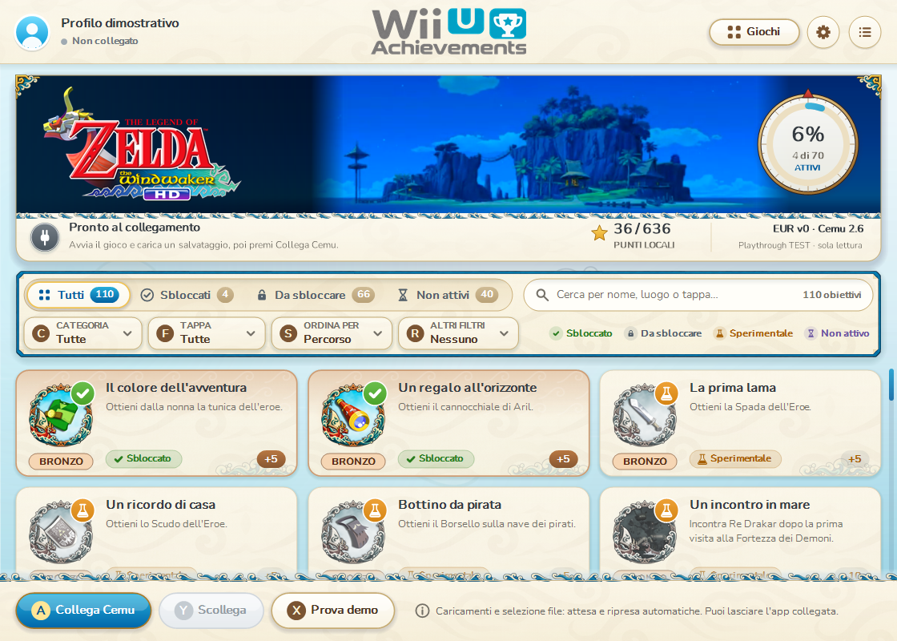

## Composition

The project logo is centred in the 80 px header, inside a 208×58 box. Profile
and connection status occupy the left (a ring around the avatar repeats the
state: solid when connected, dashed when paused, a turning arc while
connecting); navigation (Giochi, settings, log) occupies the right. Long profile
names cannot move the logo.

The banner keeps the picture and the status apart. The picture area is 116–172 px
tall depending on the window height, so short windows keep two rows of cards in
view. The game wordmark is centred in its own 248 px box at its aspect ratio and
the completion dial sits opposite. A wave seam (the owner's wave sprites) marks
the shoreline between picture and the 60 px status row: a status disc with its
own symbol (plug, check, play, pause bars, turning arc, exclamation mark), title
and detail on the left; points and configuration, or rupees/hearts/points while
connected, on the right.

Source files: `MainForm.Ui.cs` (layout, banner, bars, settings, input,
accessibility), `MainForm.Toolbar.cs` (tabs, search, menus, ordering),
`MainForm.Cards.cs` (cards, states, empty state), `MainForm.Detail.cs` (detail
browser), `MainForm.Library.cs` (catalog), `MainForm.Tiles.cs` (card cache),
`Theme.Icons.cs` (state and navigation icons), `Motion.cs` (reduced motion).

## Toolbar: tabs, search, menus and order

One parchment panel inside a simple sea frame holds every way of narrowing the
list. All earlier options are kept.

- **State tabs** Tutti / Sbloccati / Da sbloccare / Non attivi, each with an
  icon (grid, check, lock, hourglass) and a live count. The selected tab is a
  raised pill that slides between positions.
- **Search** (click or Ctrl+F) matches title, description, category, chapter and
  rarity name, ignoring case and accents; every word must match. The field shows
  "N di 110" and a clear button; Esc first clears, then leaves the field; Enter or
  Down moves to the first card. Counts in the tabs and menus follow the search.
- **Categoria (C)**, **Tappa (F)** and **Ordina per (S)** are drop-down buttons
  showing caption and current value. Click/Enter opens a menu of chips laid out
  in columns, each with its objective count; it opens upwards when the space
  below is short (900×680) and closes on choice, Esc, wheel or a click outside.
  The keys still cycle values without opening the menu.
- **Order**: Percorso (default playthrough order), Rarità, Punti, Nome,
  Sbloccati di recente. Stable sorts; no data is changed.
- **Altri filtri (R)** groups the rarity (Bronzo/Argento/Oro/Platino), detection
  (Standard/Sperimentali/Non implementati) and image (Personalizzate/Senza icona)
  filters in one menu of labelled chip rows. Each count leaves its own group out,
  so the numbers show what a choice would give. R cycles the rarity.
- Search also uses Italian/English item aliases and nicknames (e.g. *sword*,
  *pictobox*, *boss*), rebuilt when the game's rules change.
- **Azzera** appears whenever category, chapter, order, other filters or search
  differ from the defaults. A key to the four states (icon + word) fills spare
  toolbar space.

At 1120×800 and below the toolbar uses two rows; from about 1500 px it becomes one
row, and on very wide windows the search box is capped at 480 px with the state
key beside it.

| Category menu | Chapter menu at 900×680 |
| --- | --- |
| 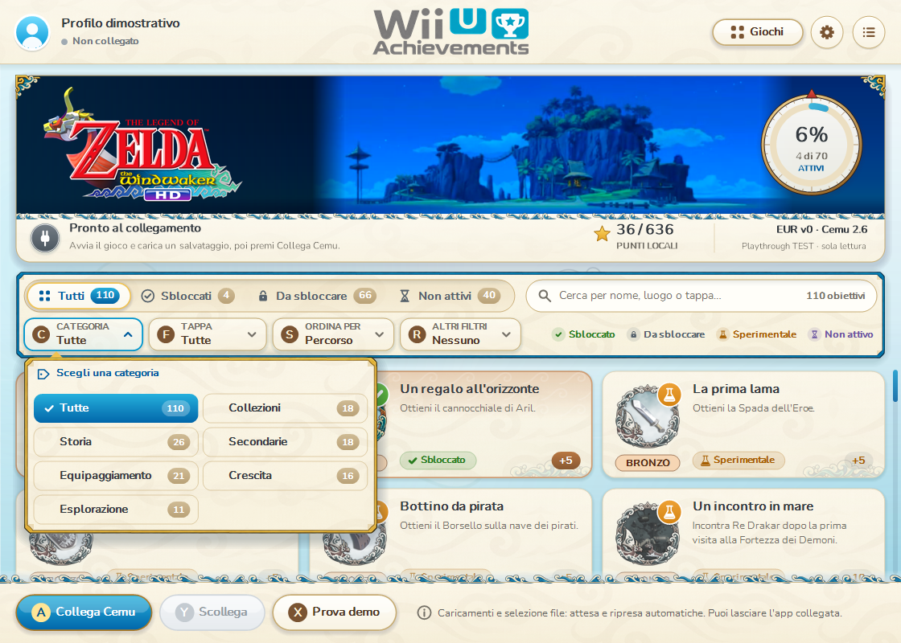 | 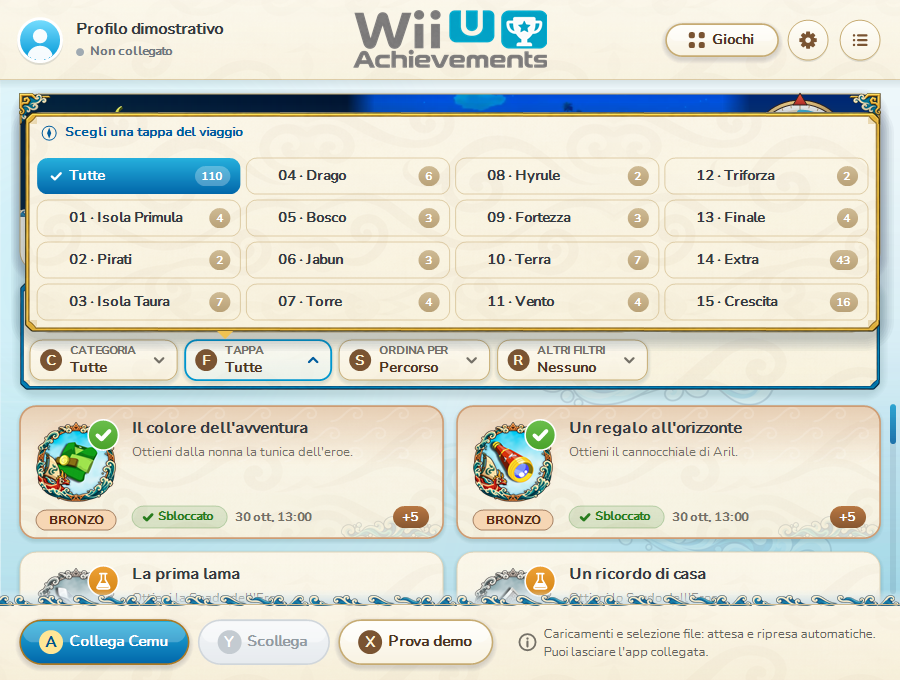 |

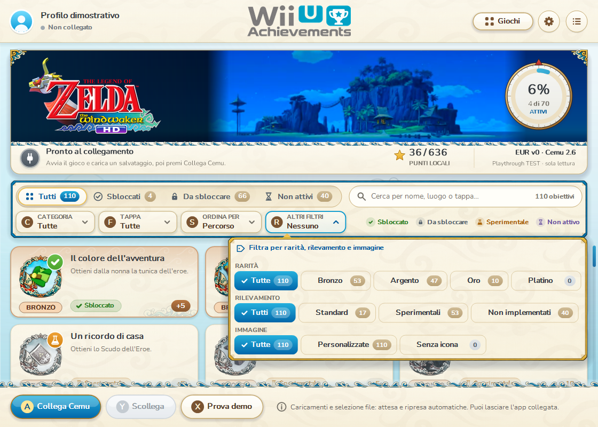

| Search | No results |
| --- | --- |
| 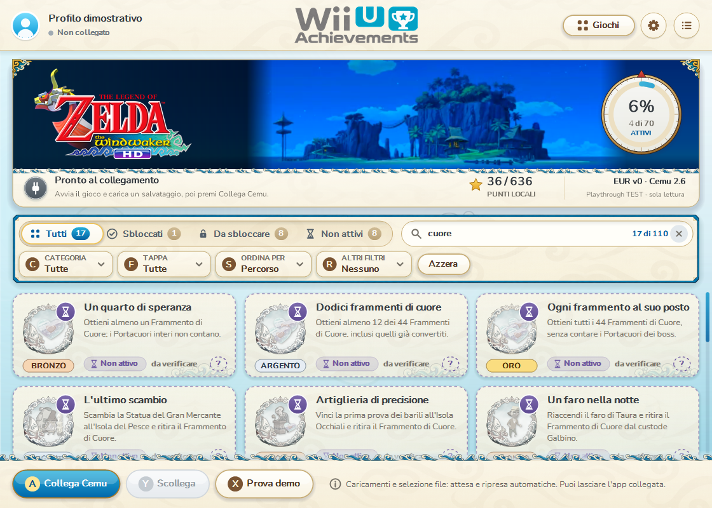 | 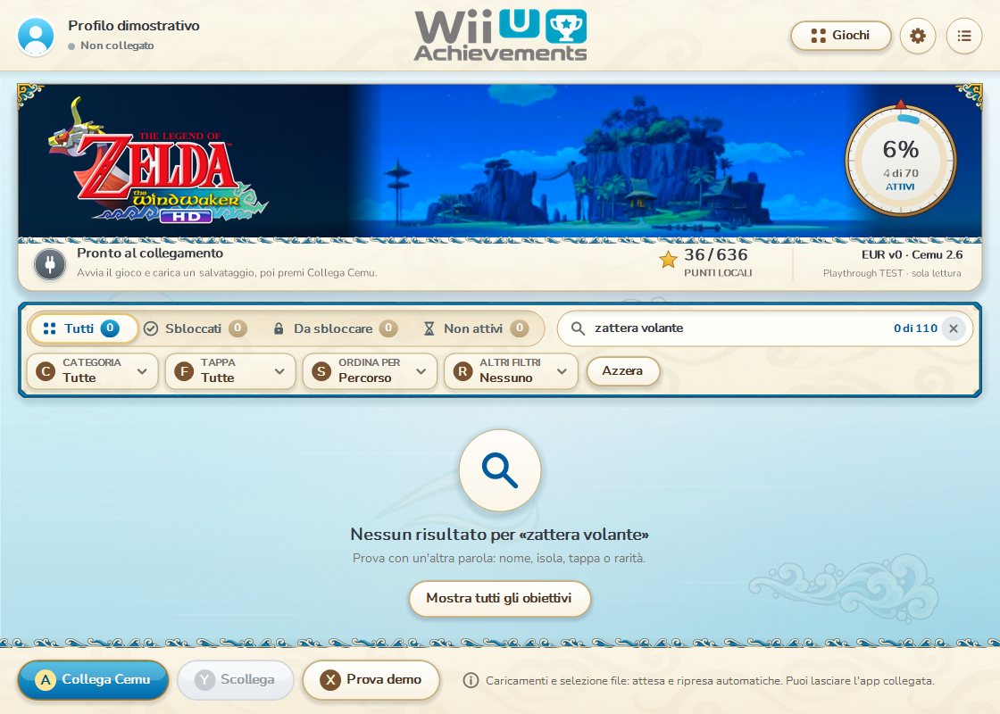 |

## Cards and states

Every 132 px card shows the medal in a soft well (rarity glow once earned), an
80×20 rarity label (dark lettering on a light metal face, fully opaque even when
locked), the title (16.5 px; long titles tighten to 15 px, then take two lines),
the description (up to three lines, tightening to 12 px before anything would be
cut), a state chip and the points. Cards are at least 340 px wide; a UI test
checks that every title and description fits whole at that width.

| State | Badge on the medal | Chip | Outline / medal |
| --- | --- | --- | --- |
| Sbloccato | green check | "Sbloccato" + date | rarity border and wash, full colour; gold/platinum wear the gold corners |
| Da sbloccare | grey lock | "Da sbloccare" | plain border, muted medal |
| Sperimentale | amber flask | "Sperimentale · da ottenere" | plain border, muted medal |
| Non attivo | violet hourglass | "Non attivo · da verificare" | dashed border, translucent card, washed medal, dashed "?" points |

States therefore read by icon, word and shape, not by colour alone. Secondary
words are shown only when they fit whole. While connected, the chip is replaced
by the live progress bar or the confirmation phase. The empty state is a
centred block (search or trophy illustration, message, "Mostra tutti gli
obiettivi").

| Hover and selection | Rarity order, unlocked tab |
| --- | --- |
| 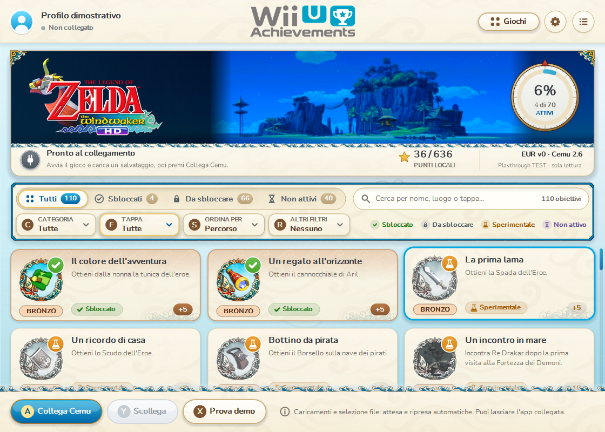 | 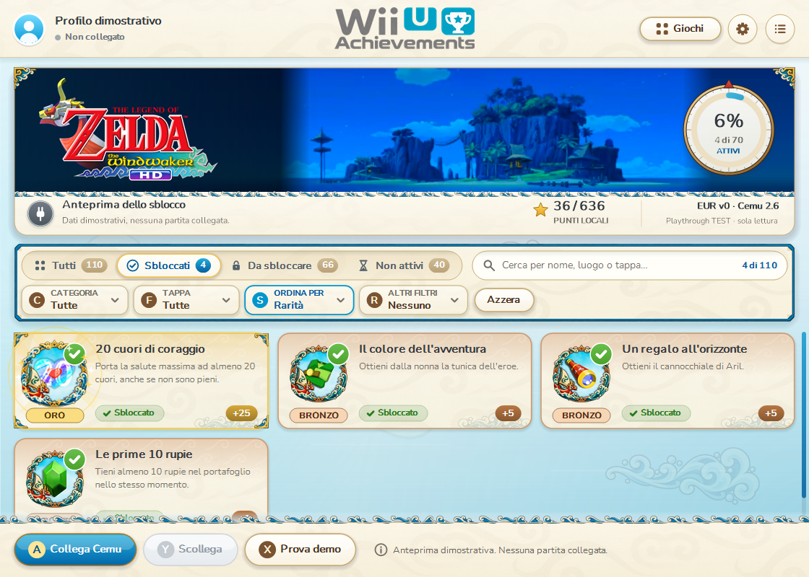 |

## Detail browser

The detail card (560 px wide, height fitted to its text) shows the medal on its
rarity light, title, rarity ribbon and points, description, state line and a
facts table (category, journey stage, detection or requirement). ‹ › buttons
beside the card and the left/right keys browse the objectives in the current
filter and order; the content slides in from the direction of travel. Closing
brings the last viewed card into view. Not-implemented objectives keep a
dashed inner outline. The close button (B/Esc) and an X are both available.

| Detail | Not implemented, 900×680 |
| --- | --- |
| 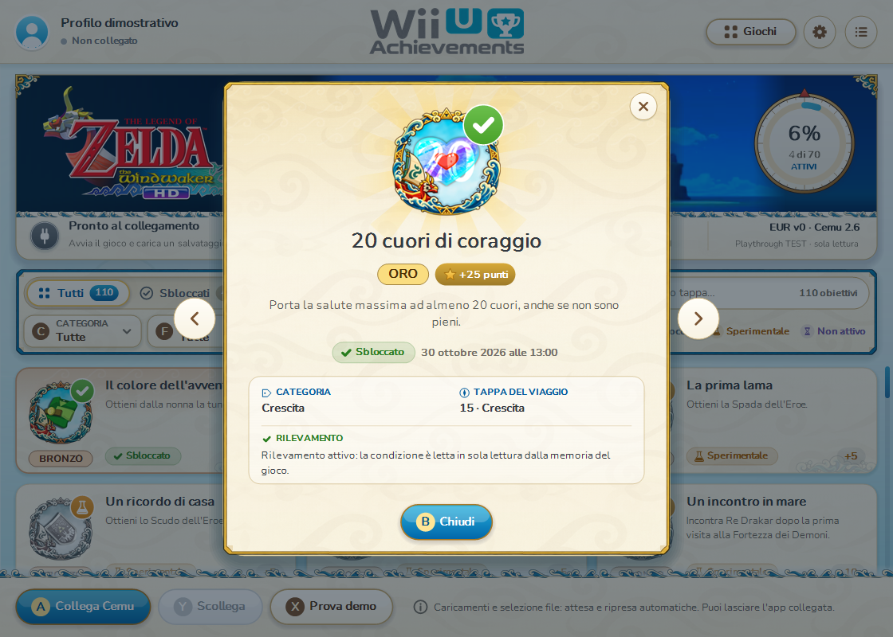 | 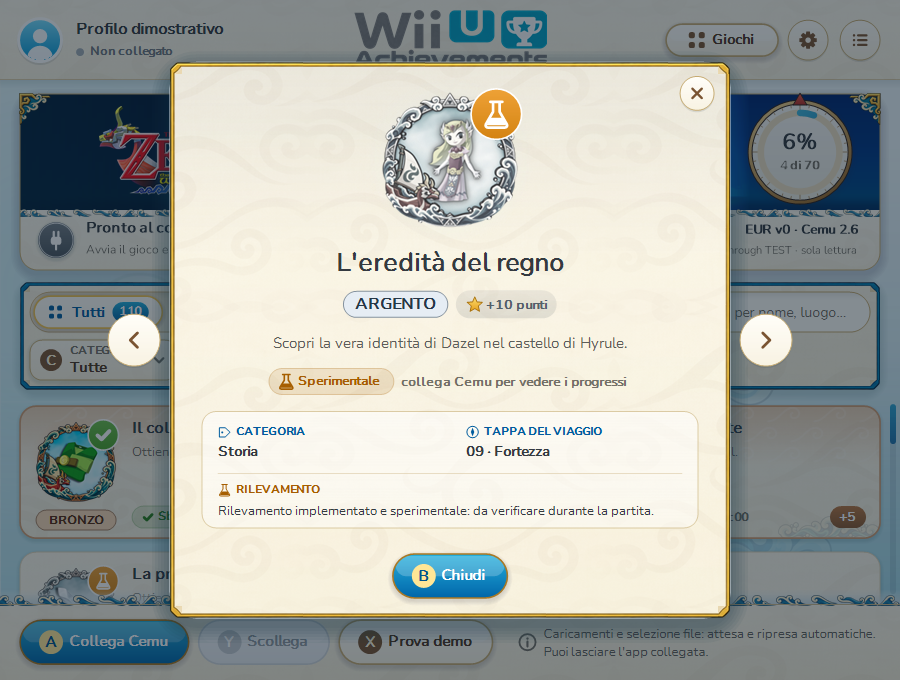 |

## Games catalog

The catalog keeps the neutral Wii U chrome. Cards are centred, 400–560 px wide
and grow with the window height (300–430 px). The selected game shows its banner
(video when available) with the round badge centred at its aspect ratio, the
supported configuration, its local progress bar and an "Apri obiettivi" action.
Future games are a dashed "In arrivo" card that cannot be activated.

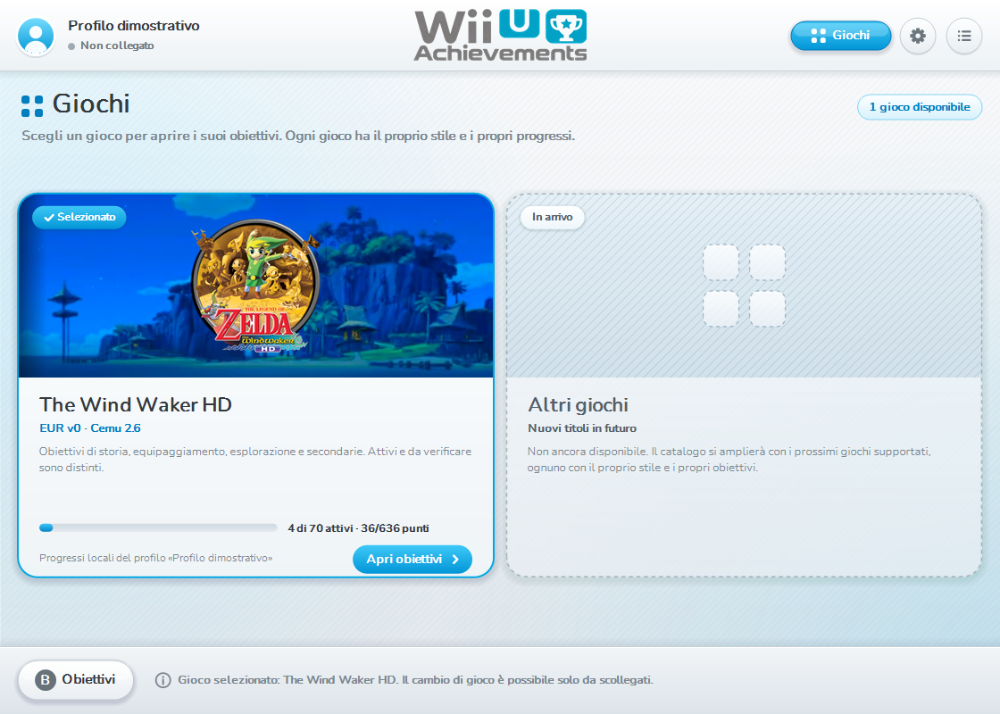

## Motion and feedback

All motion shares one timing: hover 18/s and press 30/s exponential easing,
panels (settings, log, detail) 0.26 s and menus 0.16 s with ease-out, tab
highlight and completion dial eased toward their targets. Filter changes run a
short staggered rise-and-fade of the cards in view (0.3 s each, at most 0.75 s
in total, ordered by viewport position, so scrolling never re-triggers it). Cards
lift by 3 px on hover and sink on press; buttons brighten and their outline
turns gold (Wind Waker) or cyan; the cyan selection cursor breathes gently.

Unlocks keep the grey-to-colour coin turn and add effects by rarity: bronze a
ring and six sparkles, silver rays and the shine, gold stronger rays and more
sparkles, platinum also a second ring in the popup. The synthesised chime grows
with rarity (gold/platinum add a warm low bell and a light twinkle).

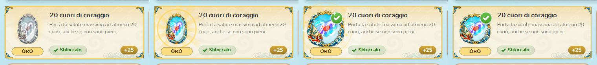

Ambient motion stays discreet: the banner video (or drawn sea) only, paused when
the window is inactive or the banner animation setting is off. A turning arc
appears only while connecting.

**Reduced motion** (Settings → Movimento ridotto) follows the Windows "Show
animations" setting until the user chooses; the choice is saved in
`settings.xml` as `<motion>`. When on: panels fade without sliding or zooming,
menus fade in place, the grid appears without entrance, the detail does not
slide, tab and dial jump to their values, unlocks change colour with a glow but
without flips, rays or sparkles, and the popup fades in place.

## Layout range

The window is fixed at 1120×840 logical pixels (no resize or maximise; smaller screens draw it at a reduced scale). The layout code still adapts to other sizes, which the UI tests keep checking.

Supported from 900×680 up to ultrawide. At 900×680 the cards use two columns of
at least 340 px and a full card row plus part of the next stays visible; at 1920×1080 the toolbar is a
single row; at 3440×1440 ten columns fit and the search field stays compact.

| 900×680 | 1920×1080 |
| --- | --- |
| 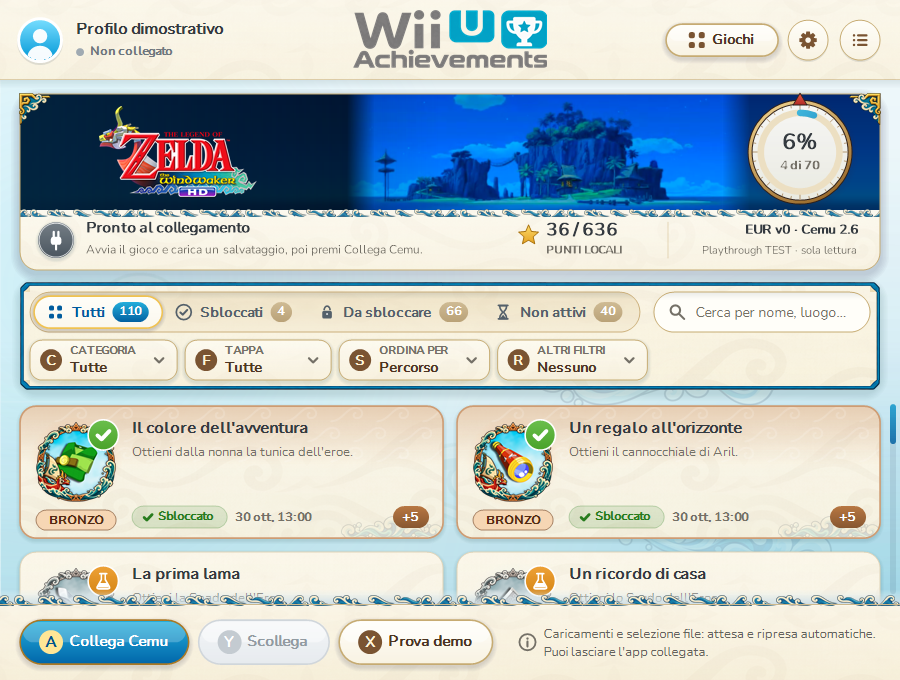 | 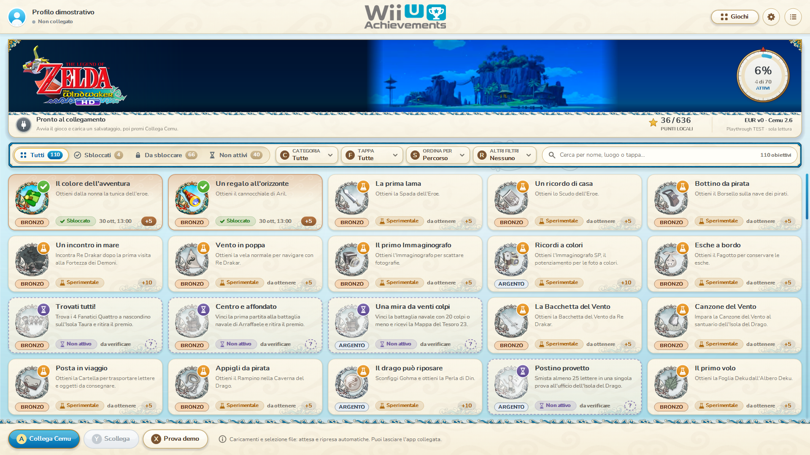 |

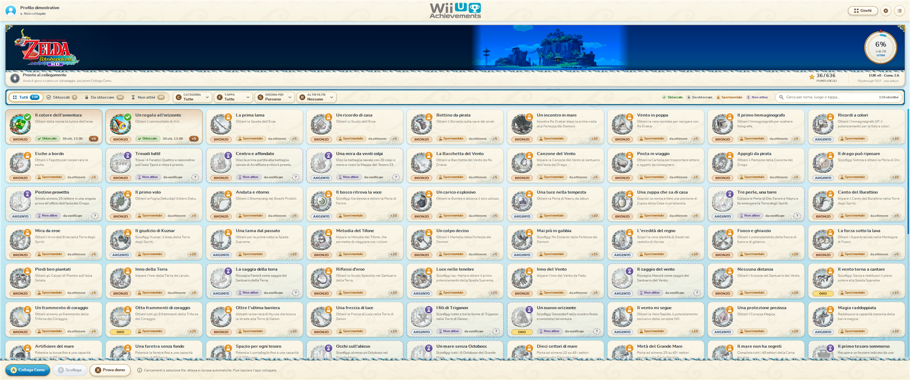

## Owner artwork, composed medals and original fallbacks

All 110 objectives have a personalized medal: 53 supplied by the owner and 57
composed on the owner's request from reviewed public Wind Waker PNGs inside the
supplied bronze/silver/gold frames (precise Pillow layering and silhouette
shadows, no generative editing). One owner icon with an incorrect baked-in song
name was replaced during the [catalog review](ACHIEVEMENT-AUDIT.md). Sources,
hashes and reproduction are in [ARTWORK-SOURCES](ARTWORK-SOURCES.md);
`tools/compose-achievement-icons.py` rebuilds them and
`tools/audit-achievement-catalog.py` checks texts, images and frame rarities.
Publication was approved by the owner; it is not a redistribution licence.

The owner supplied the project logo/trophy, two game logos, the original medal icons,
rarity frames, wallpaper video and UI kit. The kit contains 40 prepared PNGs:
parchment, simple panels/corners/rules and wind/water ornaments. Use selected
pieces in suitable places rather than forcing the complete atlas on screen.
Do not rip game files or add unrelated proprietary artwork.

- `assets/brand/`: shared project logo and multi-size EXE trophy icon.
- `assets/games/wind-waker-hd/`: game logos, medal art, frames, sky and video.
- `ui/parchment.png`: the owner's original 512×512 seamless texture, tiled on
  bars, cards, status, settings and detail panels with readable foreground text.
- Wind ornaments sit in the sky and gaps; waves decorate the footer, cards, the
  banner shoreline seam, the settings header and the log drawer. Behind the lower
  half of the Wind Waker section a turquoise sea gradient with faint swell lines
  rises; it is static and only visible between cards.
- Simple frames: the blue sea frame surrounds the toolbar panel and the supported
  configuration; the gold frame surrounds menus and the detail card.
  `SimpleFrame` scales corners uniformly and tiles straight edge strips at the
  same scale. The interior has independently tiled parchment: no illustrated
  centre or logo is stretched.
- Rarity controls medal metal, ribbon, glow and synthesised chime. Platinum is
  reserved for a future completion objective; no current target has that rarity.

`tools/prepare-ui-art.py` crops the owner's ZIP/logos, removes faint stray margins,
resizes with premultiplied alpha and isolates overlapping wave silhouettes.
`tools/prepare-game-art.py` prepares medal icons/frames/sky. These optional Python
tools are not runtime dependencies. Build resources are embedded; the installed
app does not depend on Downloads/Temp paths. Original GDI+ glyphs and the drawn
sea remain fallbacks. Nunito uses [SIL OFL 1.1](../assets/fonts/OFL.txt); keep it.
The owner requested publication of the current assets/source/docs to GitHub;
that is not a general redistribution licence for third-party works.

## Video

`VideoBanner.cs` decodes the embedded silent H.264 wallpaper through Windows
Media Foundation on a background MTA thread, with double buffering. It starts
at the part of the day matching the local clock, fits the island without changing
its aspect ratio, and extends the outer colours into wide banners. Ambient
playback pauses while the window is inactive or the setting is disabled.
Windows N/Server without media features, decoding failures and non-Windows
runtimes use the drawn sea fallback. No game capture or process write is involved.

## Rendering and performance

Static cards use a bounded lazy bitmap cache: twice the visible cards, minimum
48, maximum 400. Live footers, hover and unlock celebrations remain dynamic; the
entrance fade composes cached cards with an opacity matrix instead of redrawing
them. Layers cache header/footer/toolbar panel/banner overlays; ornaments
resample once per device size. The backdrop copies only the updated area. Banner
updates follow decoded frames; scroll invalidation stays in the grid. An opening
menu is composed offscreen and faded in; once open it is drawn directly. Cached
copies use 1:1 device pixels. See measured results in [VALIDATION](VALIDATION.md).

`Render` repaints the whole toolbar band (banner bottom to grid top, shadows
included) whenever any part of it is invalid; the grid starts below the panel
shadow so scrolling never erases it. Pixel regressions compare narrow repaints of
tabs, menus, search and the state key against whole frames at 100/125/150/200 %
offscreen scale. These checks do not assert that the Windows display scaling
setting was changed.

## Notifications

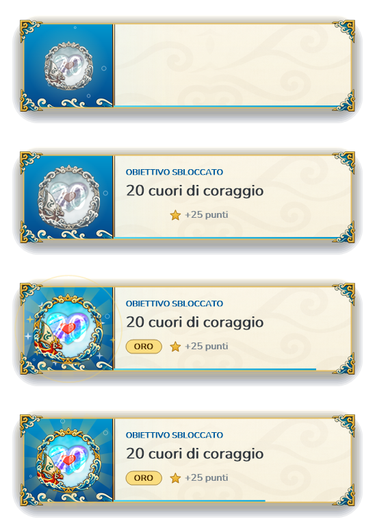

The top-centre popup is layered, click-through and does not activate the game
window. Its 5.6 s sequence reveals a grey medal, turns it to colour and adds
rarity effects (see Motion), then fades away. The chime is an original
synthesised bell arpeggio, longer and richer for rarer medals. A normal-window
fallback is used if layered drawing fails. **Prova notifica** cycles rarity
previews; verify visibility in the intended Cemu fullscreen mode independently.

## Controls, accessibility and settings

A/X/Y connect/demo/disconnect; P pauses/resumes; G opens Games; C/F/S/R cycle
category/chapter/order/rarity; Ctrl+F searches. Tab and arrows move focus (also inside
menus); Enter/Space activate; left/right browse the detail card; B/Esc close the
top layer (detail, settings, menu, log, catalog). Wheel/PageUp/PageDown scroll.
Drawn widgets expose accessible names, roles (drop-down buttons, menu items,
tabs, list items), bounds, state and actions. Settings use real text boxes; the
search box is a real text box shown while editing; passwords are masked even
when drawn during panel animation.

Settings live in `%LOCALAPPDATA%\WiiUAchievements\settings.xml` and include game,
profile, Cemu path, sound, ambient and (only if chosen) motion. Paths/profile are
read-only during a connection. Cloud login has its own settings page; see
[CLOUD](CLOUD.md).

| Settings | Locked detail |
| --- | --- |
| 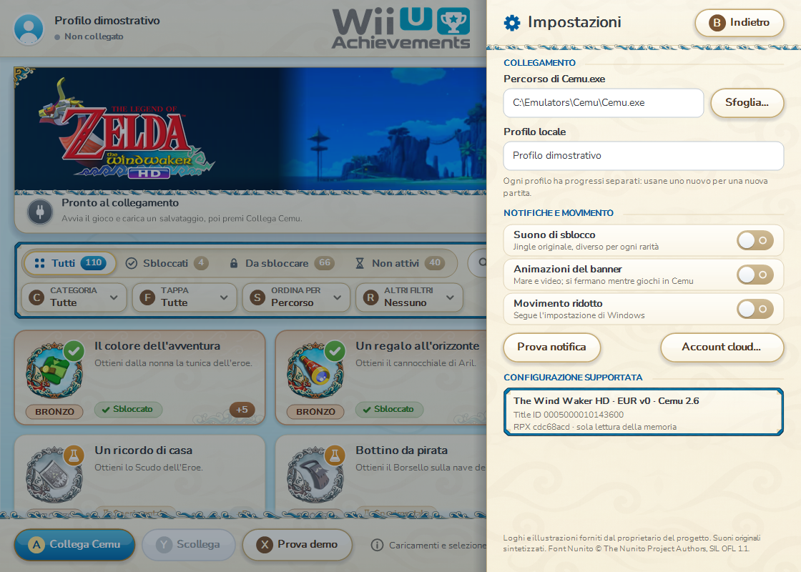 | 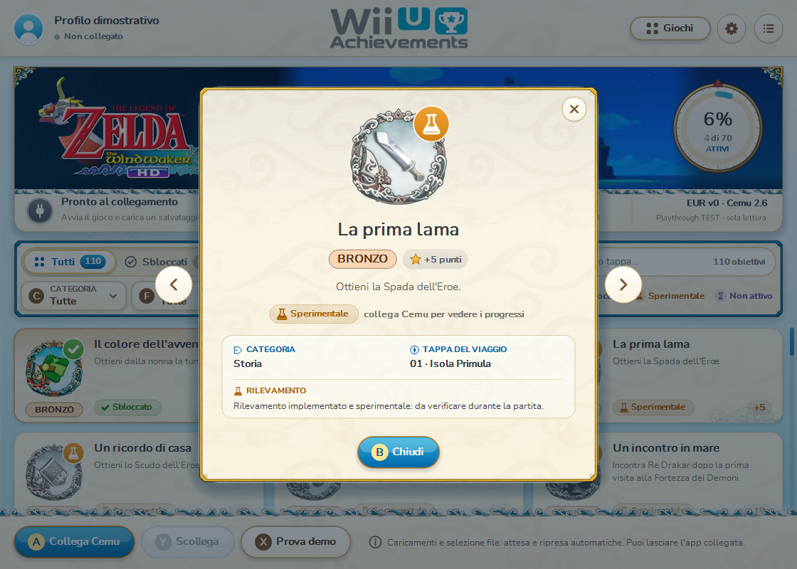 |

## Reproduce public images

Run `powershell -NoProfile -ExecutionPolicy Bypass -File .\tools\render-docs.ps1`.
It builds in Temp, uses an isolated synthetic profile and fixed example dates,
and regenerates every PNG in `docs/screenshots/` (main, hover, menus, search,
empty search, rarity order, card celebration, minimum/full HD/ultrawide sizes,
catalog, settings, details, log, pause, unlock, popups and medal sheets). No
Cemu, real progress, credentials or personal log is read. The preview harness is
not part of production. The running root EXE is preserved. No ZIP is created.

`tests/run-ui.ps1` is the regression suite; run it with a short output path
(its default under `%TEMP%` is fine), because the cloud fixture writes
`cloud.xml.<guid>.tmp` and very long folders exceed the Windows path limit.
`--preview=<png>`, `--preview-toast=<png>` and `--preview-medals=<png>` are
additional developer aids.

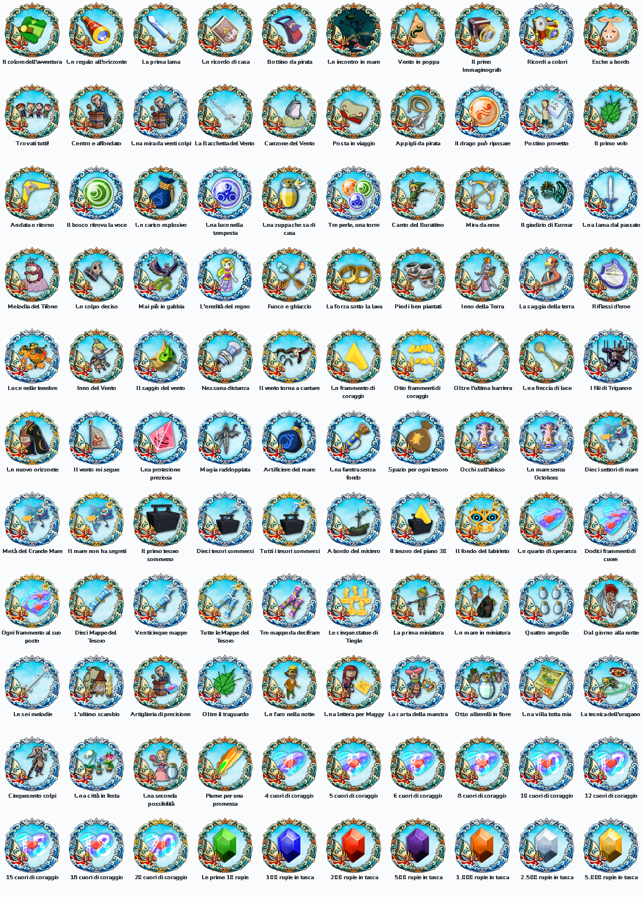
