# User interface (alpha 0.5 — Wind Waker theme)

**2026-10-30 — themed game section and banner video.** The whole objectives section
of a game now wears that game's style; the Games catalog stays in the neutral Wii U
style. For The Wind Waker HD every shared surface follows the medal frames: sky/sea
backdrop with faint wind spirals, sail-cream bars with a gold rule, foam-crested
waves along the bottom bar, the activity drawer and the popup panel, parchment cards
with a wave corner, cream pill buttons with gold rims (sea-blue primary), a compass
ring with a north point around the completion dial, gold-framed banner, dialog and
settings sheet, and a scroll crest under the title. The banner plays the owner's
Outset Island wallpaper video (dawn, day, sunset, night), starting from the part of
the day that matches the local clock.

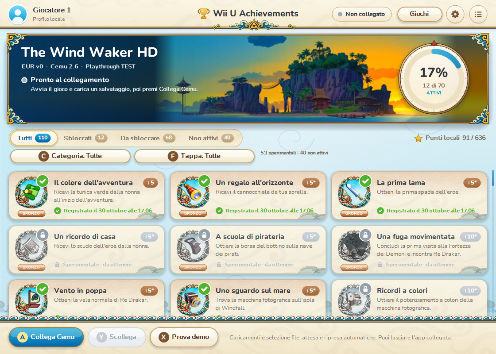

## Owner UI art (Wind Waker)

`assets/games/wind-waker-hd/ui/` holds the owner's `wind_waker_ui_assets.zip`
(2026-10-30), cropped to their visible bounds: four gold wave corners
(`corner-*.png`, ~240 px), the Triforce crest (`crest.png`, 594×86, gold rule at
77 % of its height) and the seamless sail-cloth parchment (`parchment.png`, 512 px).
`GameStyle.Corners`, `Crest` and `Parchment` draw them; each is resampled once per
device size and then copied 1:1. Placement: corners on the banner, detail dialog
and popup, and on earned gold/platinum cards; crest under the title, on top of the
dialog and on the settings header; parchment on bars, tab track, cards, dialog,
settings and popup. Without the files the drawn ornaments are used.

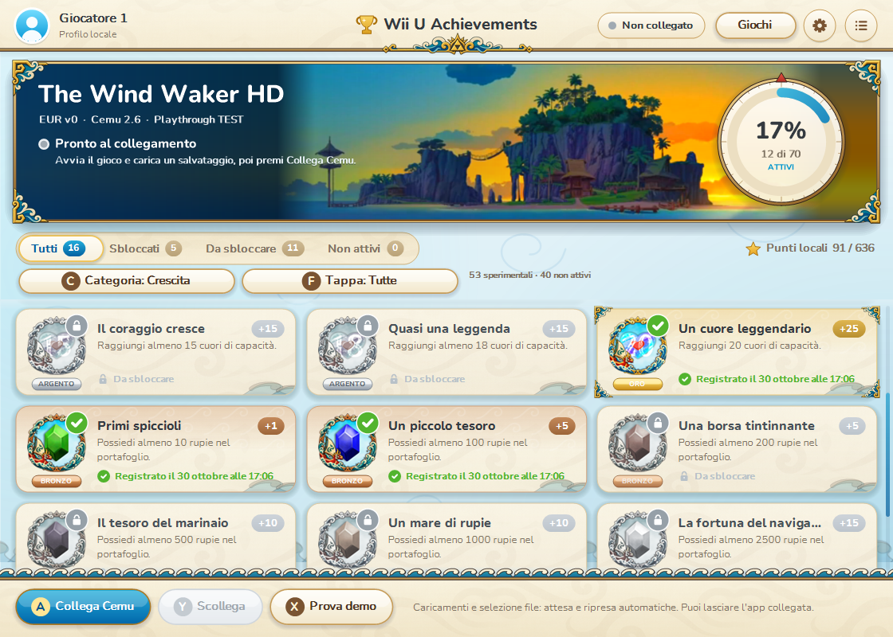

## Rendering performance

Measured on a 3440×1440 screen at 100 % (see `docs/VALIDATION.md`):

- The card cache budget is twice the cards in view (48 minimum, 400 maximum); a
  fixed 48 thrashed on ultrawide/fullscreen windows and rebuilt ~90 cards per frame.
- Footers that do not depend on live samples (pending, unlocked, disconnected) are
  baked into the cached card; live progress is still drawn every frame.
- `Animate` invalidates only what moved (hovered control, grid band, tab strip,
  banner, dialog); while the grid scrolls the banner waits, because one paint covers
  the bounding box of everything invalidated.
- The banner repaints only when the video has a new frame. Its shadow and the
  overlay (veil, frame, texts, chips, dial) are cached layers keyed by the session
  state; bars and the tab track are cached layers too (`MainForm.Layer`).
- Shadows skip the interior covered by their element; the backdrop copies only the
  repainted area; the bottom bar draws only its wave strip when the grid scrolls.
- The video's side fill is a vertical gradient of the edge colours instead of a
  magnified bitmap.
- Cached cards and layers are drawn with nearest-neighbour 1:1 copies.

## Game styles and chrome

`GameStyle` holds, per game, the palette of every shared surface (`BackTop`…`Drawer`)
and the ornaments (`Wave`, `WaveBand`, `Swirl`, `Crest`, `TrimLine`, `DecoratePanel`,
`CompassRing`, …). `MainForm.Style` returns the game's style for its objectives and
`GameStyle.Neutral` for the Games catalog; neutral values reproduce the earlier Wii U
look exactly and draw no ornaments. Ornaments are code-drawn after the frames: dark
warm outline, teal waves with cream foam, gold scrolls. Bands repainted often (bottom
bar, drawer, sheet) are rasterised once per size in `WaveBandCached`, so scrolling costs
the same as before. Body text keeps the Wii U ink; secondary text uses the style's
warm grey; the selection cursor keeps the Wii U cyan.

## Banner video

`VideoBanner` decodes `assets/games/<game>/banner.mp4` (embedded; copied once to
`%TEMP%\WiiUAchievements-media`) with Windows Media Foundation (`mfplat`,
`mfreadwrite`, part of Windows) on a background MTA thread into a double buffer.
It shows the first frame at once, plays at the file's pace only while ambient
animation runs (window active, setting on) and pauses otherwise, so it costs nothing
while you play in Cemu. A key-frame seek is decoded forward to the requested time.
The picture is fitted to the banner height around a focus box (island from palm tops
to the jetty) and anchored right of the title; when the banner is wider, the outer
columns of a tiny blurred copy continue sky and sea, and an alpha feather blends the
sharp picture into them. A sea-blue veil keeps the title readable. If Media
Foundation is unavailable (Mono, Windows N/Server without media features) or any
frame fails, the original drawn `OceanBanner` is used.

**2026-10-30 — owner icons, rarity frames and game styles.** The 28 icons supplied
by the project owner replace the medals of the objectives whose titles they carry.
Every other objective uses an original cel-shaded glyph on the same sky, inside the
same frame, so all 110 medals share one look. The frame metal follows the curated
rarity (bronze, silver, gold; platinum reserved). Each game has a `GameStyle`:
Wind Waker uses sea blues, sail cream and foam-curl motifs; the Wii U system chrome
(bars, buttons, settings) stays common. Unlock animations were reworked: medals turn
like a coin from grey to colour, with rarity-coloured rays, burst ring and sparkles,
and each rarity has its own chime. IDs, points, revision and progress are unchanged.

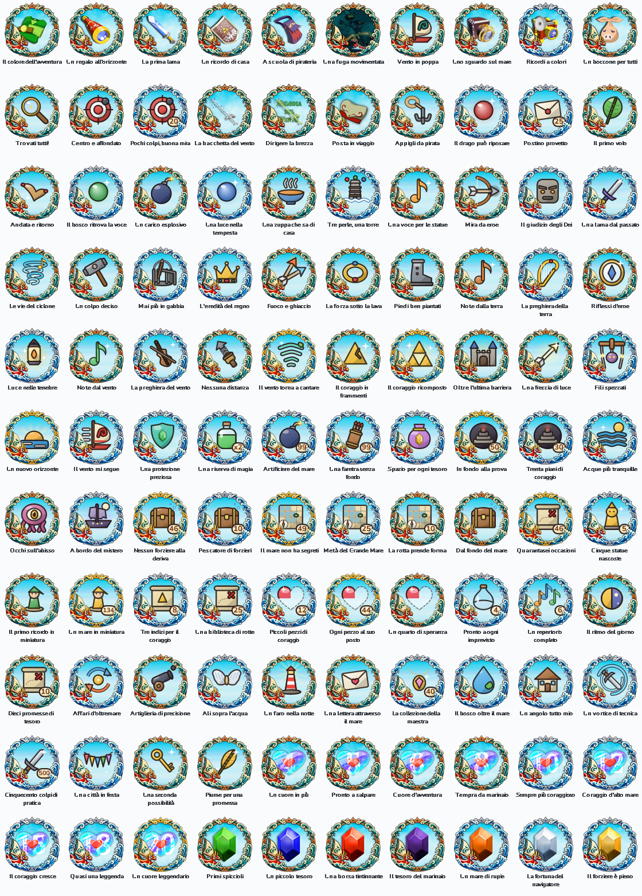

The expanded catalog adds a fourth status tab, **Da verificare**, and a category
cycle button (**C**). The six categories are Storia, Equipaggiamento,
Esplorazione, Collezioni, Secondarie and Crescita. Status and category filters
combine. The ring and point total include only the 70 executable objectives,
including 53 explicit experiments. The 40 pending cards display `?` instead of claimable points, an orange **Non attivo**
label, and a detail explanation of the missing verification. Accessibility help
includes the category, pending requirement and explicit absence of automatic
unlocks. No pending card queries snapshot
fields or changes recording state.

**Tappa / F** cycles the chronological groups, independently of **Categoria / C**.
The default list starts with the tunic, telescope, sword and shield and follows
the approximate playthrough order; growth thresholds are at the end. Metadata
never prevent free exploration. Experimental cards use a `*` in the points pill,
explicit detail text and a marked unlock notification. They can unlock; pending
cards cannot. The title banner identifies this build as **Playthrough TEST**.

The window and the unlock popup are custom-drawn WinForms surfaces styled after
the light Wii U system menus: a pale striped backdrop, white rounded cards, pill
buttons with GamePad face-button glyphs (A/B/X/Y), a cyan selection cursor and a
cel-shaded sea banner for the game.

## Asset policy

- **No ripped Nintendo files.** Interface shapes (glyphs, trophy, clouds, waves,
  island, avatar, buttons) are drawn with GDI+ in code. Nothing was ripped from the
  console, a game or a website. Do not add Nintendo logos, Miis, menu textures,
  sounds or the proprietary system font.
- **Owner artwork (exception, 2026-10-30).** `assets/games/wind-waker-hd/` holds
  the 28 medal icons the project owner supplied (named after achievement titles,
  stored by achievement ID at 256 px) plus `frame-<rarity>.png` and `sky.png`,
  which `tools/prepare-game-art.py` extracts from those icons: per-rarity median,
  centre removed, platinum derived from silver. `build.ps1` embeds every PNG as
  `WiiUAchievements.Games.<game>.<path>`; the EXE needs no files beside it. Add
  more such art only at the owner's explicit request. The icons depict the game's
  world: keep that in mind before any public redistribution.
- **Owner video (exception, 2026-10-30).** `assets/games/wind-waker-hd/banner.mp4` is
  the owner's 640×360 H.264 wallpaper (5 min 18 s), audio removed with
  `ffmpeg -an -c:v copy` (4.06 MB). It is third-party footage of the game's world.
- **Font:** Nunito Regular/Bold/ExtraBold, © The Nunito Project Authors, SIL Open
  Font License 1.1 (`assets/fonts/OFL.txt`). The three static TTFs come from the
  Google Fonts API. `build.ps1` embeds them as manifest resources named
  `WiiUAchievements.Fonts.<file>`. Keep `OFL.txt` next to the fonts.
- **Sound:** `Chime.Build(tier)` creates a bell arpeggio as an in-memory 16-bit WAV:
  bronze C6–G6–C7, silver C6–E6–G6–C7, gold C6–E6–G6–C7–E7, platinum adds G7–C8.
  There is no sound file.

## Source map

| File | Responsibility |
| --- | --- |
| `src/MainForm.cs` | Session logic: connect, demo, sampling, settings, toast queue. Catalog/profile routing, recording pause/resume and engine state updates. |
| `src/MainForm.Ui.cs` | Layout, painting, animation timer, mouse/keyboard input and accessibility of the main window. |
| `src/MainForm.Tiles.cs` | Bounded lazy bitmap cache for static achievement cards; live footers and animated cards remain dynamic. |
| `src/MainForm.Library.cs` | Game catalog using the same rounded cards, sea artwork and input widgets. |
| `src/Theme.cs` | Palette, fonts, easing, text helpers, rounded shapes, shadows, cursor, rarity metals (`TierColors`, `TierGlow`, `TierRibbon`) and the vector fallback medal. |
| `src/GameStyle.cs` | Per-game palette, embedded artwork loader (icons, frames, sky) and the game's repeating motif. |
| `src/Medals.cs` | `Art` (rule → rarity, icon or glyph) and `Medals`: bounded cache of rasterised medals per size and locked state. |
| `src/Glyphs.cs` | Original cel-shaded item glyphs and the explicit Wind Waker ID → glyph table, plus the number plate for series. |
| `src/VideoBanner.cs` | Media Foundation banner video: background decoding, pause/resume, focus fit, blurred side fill, feathered edges. |
| `src/Banner.cs` | `OceanBanner`: cached sky layer plus animated clouds, swell rows, foam and sparkles. |
| `src/Notification.cs` | `ToastForm` unlock popup, `Layered` (UpdateLayeredWindow) and `Chime`. |

## Rendering model

- Layout uses a 96-DPI logical canvas. `scale = DpiX / 96` is applied once with
  `ScaleTransform`. Mouse coordinates are divided by the same factor.
- `Arrange()` rebuilds the visible widget list (buttons, tabs, tiles, toggles,
  fields) on every paint and hit test. Widgets keep the same identity by id, so
  hover/press animation state survives a relayout.
- `Render()` draws the cached backdrop, then grid, tabs, banner, top bar, log
  drawer, bottom bar, settings sheet and detail dialog. Each layer is skipped
  when it lies outside the invalidated rectangle.
- A 15 ms `animation` timer advances hover/press, sheet/drawer/dialog transitions,
  the tab highlight, smooth scrolling, the progress ring, the rupee counter,
  staggered tile intros and unlock celebrations. It stops itself when nothing
  moves. Ambient motion (banner sea, status-dot pulse, focus pulse) runs only while
  this window is the active window and the setting is enabled. It pauses while
  the player is in Cemu, so it uses no CPU then.
- Scrolling invalidates only the grid while other UI state is steady. Static
  cards (background, shadow, medal, title, description, point pill) are rasterized
  lazily at device resolution and reused. A 48-entry least-recently-used cache
  bounds native bitmap memory and disposes replaced/evicted entries. Resize,
  game selection and form disposal clear it. Unlock state changes rebuild the
  corresponding image. Progress/status footers are drawn live every frame;
  hovered/focused/pressed or celebrating cards retain vector animation. The
  intro stagger counts viewport cards so scrolling far down a long list does
  not introduce a delay proportional to the achievement's catalog index.
- The sampling timer remains 100 ms. Pause stops it; resume establishes a new
  baseline. Per-rule confirmation and blocked states come directly from the engine.

## Achievement visuals

`Art.For(rule, allRules, gameId)` derives the medal without new XML fields:

- **Owner icon:** if `assets/games/<game>/icons/<id>.png` exists it is the whole
  medal (its frame already has the rarity metal). 28 Wind Waker objectives: all
  16 rupee/heart thresholds plus 12 story/equipment items.
- **Glyph medal:** otherwise the game's sky, an explicit glyph from `Glyphs`
  (sail, pearls, master sword, notes, charts, chests…, with a cream number plate
  for series such as 10/25/49) and `frame-<rarity>.png` on top, so the boat and
  waves overlap the item exactly as in the supplied icons. Every Wind Waker ID has
  an explicit glyph; unknown IDs of future games fall back to a category emblem.
- Games without artwork use the original vector medallion (`Theme.VectorMedal`).
- Medal tier comes from explicit editorial rarity, independently of points.
  See `RARITIES.md`: 53 bronze, 47 silver, 10 gold; platinum is reserved for the
  future set-completion trophy. Frame, ribbon under the medal, card edge and wash,
  points pill, rays, sparkles, popup glow and chime all use the same rarity metal.
- Locked medals are the same picture through a colour matrix (86 % desaturated,
  lifted) with a lock badge. Unlocked medals get a green check, a rarity-tinted
  card with the game's foam motif and a rarity-coloured edge.

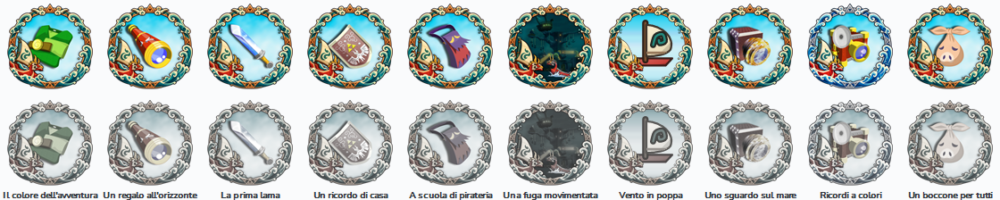

Tile footer states:

- **Unlocked:** local date and time.
- **No data:** "Da sbloccare".
- **Live below threshold:** progress bar and value.
- **Baseline settling below threshold:** "Sincronizzazione…".
- **At or above threshold during confirmation:** "Verifica 1/3", then "Verifica 2/3".
- **At or above threshold without a stable lower baseline:** "Soglia già raggiunta
  all’avvio". These states come from `AchievementEngine.Status`; no duplicate
  baseline logic lives in the interface.
- **Paused:** "Registrazione in pausa" for locked objectives; saved objectives
  keep their date, points and medal.

An unlock plays a 2.2 s celebration on its tile: the grey medal turns like a
coin and comes back in colour, pops, emits a rarity-coloured burst ring, rays and
sparkles, while a shine sweeps the card and the edge glows. Hovered cards lift and
their medal grows slightly. The detail dialog's medal enters with a small bounce
and, once earned, floats gently over slow rarity rays. The ring, bars and backdrop
use the game palette.

| | |
| --- | --- |
| 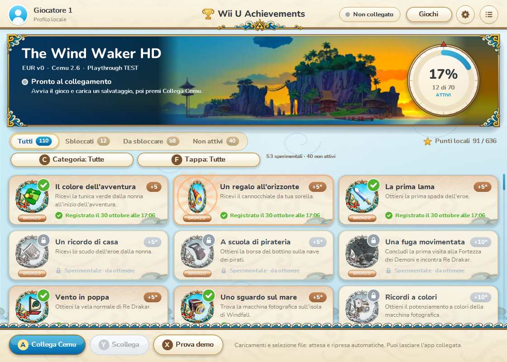 | 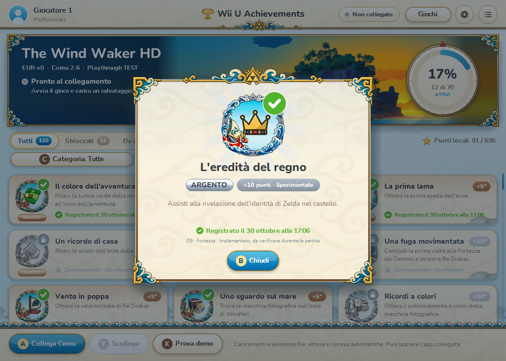 |

## Game catalog and recording pause

**Giochi** in the top bar, or **G**, opens a separate catalog view. The existing
main screen, theme, Nunito fonts, sea artwork, medals and popup are preserved.
The catalog shares the widget, focus and accessibility infrastructure, including
disabled states for unavailable titles. It scrolls when further rows are added.
See `GAMES.md` for the adapter/registration boundary.

While attached, **Pausa / Riprendi** replaces the disconnected-only **Prova demo**
button in the same bottom-bar space. **P** operates it from the objectives view.
The program explicitly says the game continues during recording pause. Catalog
navigation does not alter recording state. **B / Esc** closes the top surface
(settings, detail, drawer) and then returns from the catalog.

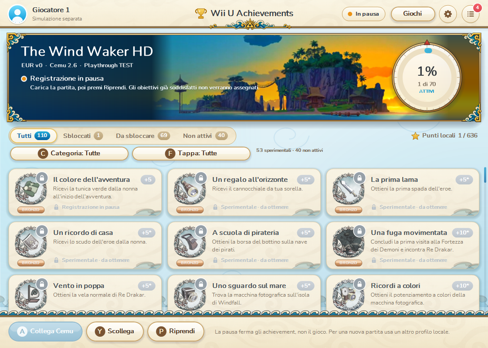

## Unlock popup

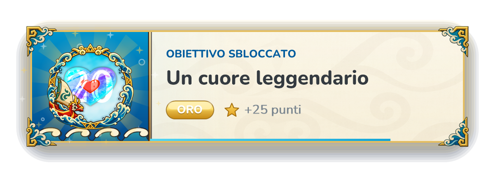

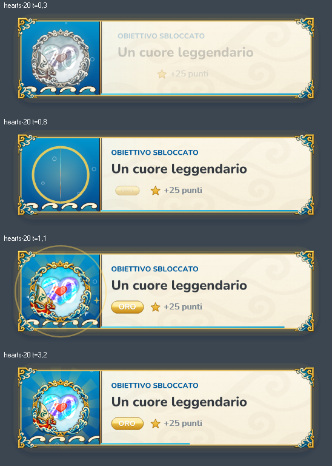

- A top-most `WS_EX_LAYERED | WS_EX_TRANSPARENT | WS_EX_NOACTIVATE |
  WS_EX_TOOLWINDOW` window updated through `UpdateLayeredWindow`. This gives
  per-pixel alpha (soft shadow, glow, rounded corners). It never takes focus,
  and clicks pass through it to the game.
- It appears top-centre on the monitor that shows Cemu's main window. Demo and
  preview popups appear on the app's monitor.
- Layout: the left panel carries the game style (Wind Waker: sea gradient,
  drifting foam curls, rising bubbles, a light behind the medal); the right side
  shows header, title, rarity ribbon and points. Border and halo use the rarity
  metal, brighter for gold and platinum.
- Timeline (5.6 s): slide down with overshoot, grey medal pop, text reveal; at
  0.62 s the medal turns like a coin into colour (`ToastForm.TurnStart`/`TurnTime`)
  with burst ring, rotating rays, sparkles and the rarity ribbon popping in; then a
  shine sweep, the countdown bar and slide up/fade. The chime matches the rarity.
- If `UpdateLayeredWindow` fails, `Layered.Disabled` is set. The same unlock is
  then shown again in a plain rounded popup with opacity fades. Non-Windows
  runtimes always use that fallback.
- "Prova notifica" in the settings panel queues a preview popup labelled
  "ANTEPRIMA", cycling bronze → silver → gold on each press. Use it to check that
  popups appear over the game in the chosen Cemu fullscreen mode.

## Input and accessibility

| Input | Action |
| --- | --- |
| Mouse | Hover shows the cyan cursor. Click a tile for the detail dialog. Wheel scrolls the grid or the log. |
| Tab / Shift+Tab | Move focus through the controls in the active layer, text fields included. |
| Arrow keys | Spatial navigation (nearest control in that direction), like the Wii U Menu. |
| Enter / Space | Activate the focused control. |
| A / X / Y | Connect Cemu / start demo / disconnect, when no panel is open. |
| B / Esc / Backspace | Close the dialog, the settings panel or the log, in that order. |
| Page Up / Page Down | Scroll the grid. |

The form overrides `CreateAccessibilityInstance`. Each drawn control is exposed
as an `AccessibleObject` with a name, role, state, screen bounds and a default
action. The real text boxes are exposed through their own accessibility objects.
The status text is mirrored in the form's `AccessibleDescription`.

## Settings

`data/settings.xml` remembers the selected catalog ID in `<game>` and keeps the
two optional UI elements: `<sound>` and `<ambient>`, both
`true`/`false`. Older files without them load with both enabled. The settings
panel saves immediately when a toggle changes. The Cemu path and profile remain
read-only while a session or the demo is running. Progress identity and the
achievement set revision (`wwhd-alpha-1`) are unchanged.

## Developer aids

- `tests/run-ui.ps1`: isolated no-Cemu UI smoke suite and full/minimum-size PNGs.
- `--preview=<png>`: renders the main window after 1.2 s, then exits. It uses
  the same `Render()` path, not a screen grab.
- `--preview-toast=<png>`: renders one popup frame with transparency, then exits.
- `--preview-medals=<png>`: renders every medal of the default game, unlocked and
  locked, with titles, then exits.
- `tools/prepare-game-art.py <folder> <game>`: regenerates icons, frames and sky
  from the owner's full-size PNGs (optional Python + Pillow/NumPy/SciPy).

Screenshots in `docs/screenshots/` were rendered on Windows 11 by the app's own
`Render()`/`ToastForm.Render()` paths on 2026-10-30 (synthetic progress, no Cemu).

| | |
| --- | --- |
| 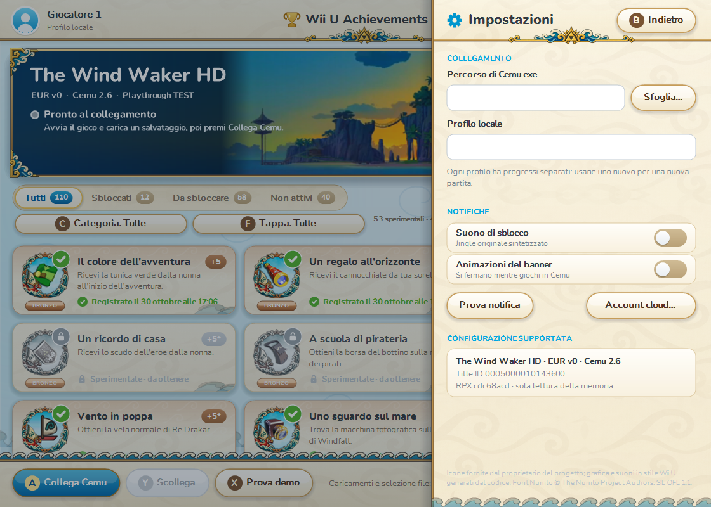 | 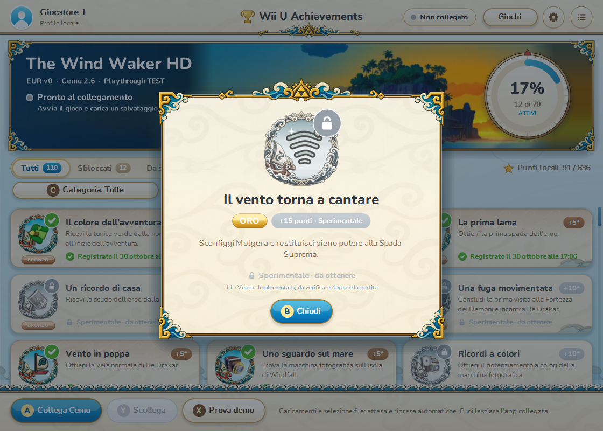 |
| 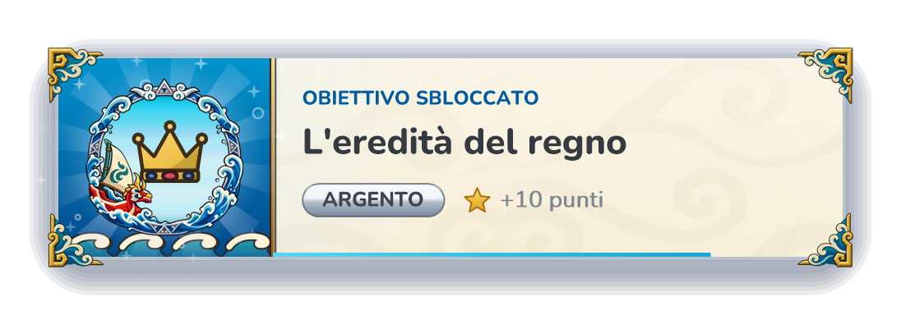 | 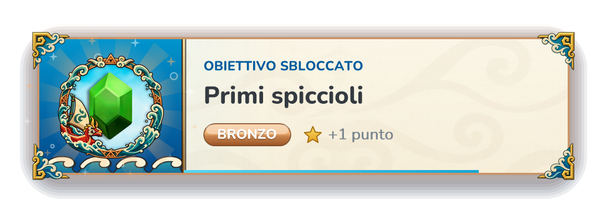 |
